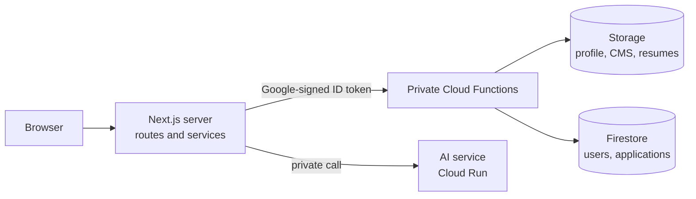

<div align="center">


# Asterion AI

**A self-hosted personal site, resume builder and job tracker, with a clean light and dark design.**

[](https://github.com/AbhirupGhosh92/beatrix.ai/actions/workflows/ci.yml)
[](LICENSE)


[Features](#features) · [Quick start](#quick-start) · [Configuration](#configuration) · [Self-hosting](#self-hosting) · [Contributing](#contributing) · [License](#license)

</div>

---

Asterion AI is a single-page bio and resume site for recruiters, plus a signed-in workspace with a **resume builder** and a **job application tracker**. All copy lives in one JSON file, so you can make it yours without touching a component, and the whole stack (Firebase, Cloud Functions, Terraform, CI/CD) is in this repository so you can run your own copy.

## Contents

- [Features](#features)
- [Tech stack](#tech-stack)
- [Architecture](#architecture)
- [Quick start](#quick-start)
- [Configuration](#configuration)
- [Self-hosting](#self-hosting)
- [Scripts](#scripts)
- [Project structure](#project-structure)
- [Design system](#design-system)
- [Development workflow](#development-workflow)
- [Documentation](#documentation)
- [Contributing](#contributing)
- [Security](#security)
- [License](#license)

## Features

**Public site**

- Hero with rotating roles, an avatar with a 3D hover and a copy-email button.
- Animated stats, an "About" told as a chat, draggable before/after achievement cards, a role timeline, tabbed skills, education and a "beyond code" section.
- Scroll animations built with [Framer Motion](https://www.framer.com/motion/): sections reveal as you scroll, the hero eases away, and a progress bar tracks the page. Everything is static when the visitor prefers reduced motion.
- Light and dark themes that share one design and differ only in color; the choice is remembered and defaults to the operating system setting, with no flash on load.
- Responsive from 320px to 1920px. Text contrast is checked in both themes.

**Signed-in workspace** (Google sign-in, role based)

- **Resume builder**: a structure-driven editor with live PDF preview, templates, a resume score and export to PDF, DOCX and Markdown. Exports are generated in the browser.
- **Job tracker**: applications with status, labels, notes and a posting link, with search, sorting and filters, and tailored resumes created straight from an application.
- **AI actions** (skill match and tailor for a job): the interface and the private service are in place, and the results are labelled placeholders until you connect a model.

**Administration**

- A JSON **CMS** at `/admin/cms` for the profile and resume configuration (Monaco editor, versioned backups).
- An **access** panel at `/admin/access` to add users, change roles and revoke access. Roles are `reader`, `user-base`, `user-advanced` and `admin`, and the server decides what each can do.

**Operations**

- Infrastructure as code with Terraform, a guarded two-environment deploy pipeline (`dev` on every merge, `prod` by hand with approval) and automatic release notes. See [Self-hosting](#self-hosting).

## Tech stack

| Area | Tools |
| --- | --- |
| App | Next.js 16 (App Router), React 19, TypeScript 6 |
| UI | Tailwind CSS v4 (CSS-first config), daisyUI v5, Framer Motion, lucide-react |
| Documents | `@react-pdf/renderer`, `docx`, Monaco editor |
| Backend | Firebase (Auth, Firestore, Storage, App Hosting), Cloud Functions for Firebase (Node 22) |
| AI service | FastAPI on Cloud Run (`ai_backend/`, stub routes for now) |
| Infrastructure | Terraform, GitHub Actions with Workload Identity Federation |
| Workflow | OpenSpec (spec-driven changes), ESLint 10 flat config |

## Architecture

The browser only talks to the Next.js server. Only that server calls the private Cloud Functions, so function URLs, tokens and payloads never reach a client.



Access is default-deny: every route except the home page needs a server-verified session cookie, and the `admin` role is required for `/admin`. See [`docs/DEPLOYMENT.md`](docs/DEPLOYMENT.md) and [`openspec/specs/`](openspec/specs/) for the details.

## Quick start

You need Node.js 20.9 or later and npm (or pnpm).

```bash
git clone https://github.com/AbhirupGhosh92/beatrix.ai.git
cd beatrix.ai
npm install
npm run dev
```

Open <http://localhost:3000>. Without a backend the site renders a placeholder profile from `src/data/profile.example.json`, so you can see the design straight away. Sign-in, the resume builder, the job tracker and the admin panel need the Firebase backend described in [Self-hosting](#self-hosting).

## Configuration

### Your content

Personal data is deliberately **not** committed.

1. Copy `src/data/profile.example.json` to `src/data/profile.json` (git-ignored) and fill in your details. Use only real facts and metrics.
2. Optionally add `public/avatar.jpg` and your resume (for example `public/resume.docx`, matching `person.resumeFile`). Both are git-ignored.
3. The shape of the file is the `Profile` interface in `src/data/profile.ts`. Keys missing from your file fall back to the example, so new fields never break an older profile.

In a deployed environment the profile is stored in Firebase Storage and edited in `/admin/cms`; edits go live within about 30 seconds, and the previous version is kept.

### Environment variables

Set these in `.env.local` for local development.

| Variable | Purpose |
| --- | --- |
| `NEXT_PUBLIC_FIREBASE_PROJECT_ID` and the other `NEXT_PUBLIC_FIREBASE_*` values | Firebase web app config for sign-in and analytics. On Firebase App Hosting these are filled in automatically. |
| `FUNCTIONS_CALLER_SERVICE_ACCOUNT` | `firebase-app-hosting-compute@<project>.iam.gserviceaccount.com`, so your dev server can call the private functions. Your account needs the Service Account Token Creator role on it. |
| `AI_BACKEND_URL` | Address of the AI service, if you run it. |

## Self-hosting

Each environment (`dev`, `prod`) is its own Google Cloud and Firebase project, created by the same Terraform.

1. Create a Google Cloud project, link billing (Firebase's Blaze plan) and install `gcloud`, `firebase` and `gh`.
2. Copy `terraform/environments/dev.tfvars` and set your project id and admin email.
3. Run `./scripts/recreate-environment.sh dev`. It is safe to re-run; when a step only you can do is missing (enabling Storage, the Google sign-in provider), it stops with an **ACTION REQUIRED** list.
4. Add yourself as the first admin with `scripts/add-admin.sh dev you@example.com`.
5. Merge to `main`; the **Deploy dev** workflow deploys it. **Deploy prod** runs only by hand (`./scripts/deploy-prod.sh <version>`), needs a reviewer's approval, and cuts a GitHub release from [`RELEASE_NOTES.md`](RELEASE_NOTES.md).

The deploy pipeline never destroys data (plans that delete or replace stateful resources are blocked), and its guarantees, one-time GitHub setup, rollback and restore runbooks are in [`docs/DEPLOYMENT.md`](docs/DEPLOYMENT.md). Terraform details are in [`terraform/README.md`](terraform/README.md), and the AI service is described in [`ai_backend/README.md`](ai_backend/README.md).

## Scripts

<!-- scripts:start -->
| Command | Runs |
| --- | --- |
| `npm run dev` | `next dev` |
| `npm run build` | `next build` |
| `npm run lint` | `eslint .` |
| `npm run start` | `next start` |
| `npm run typecheck` | `next typegen && tsc --noEmit` |
| `npm run lint:fix` | `eslint . --fix` |
| `npm run check` | `npm run typecheck && npm run lint` |
| `npm run clean` | `rm -rf .next out next-env.d.ts *.tsbuildinfo` |
| `npm run functions:build` | `pnpm --prefix functions run build` |
| `npm run deploy:functions` | `bash scripts/deploy-functions-dev.sh` |
| `npm run infra:preflight` | `bash scripts/env-preflight.sh` |
| `npm run functions:serve` | `pnpm --prefix functions run build && firebase emulators:start --only functions,firestore,storage,auth` |
| `npm run infra:recreate` | `bash scripts/recreate-environment.sh` |
| `npm run infra:seed` | `bash scripts/seed-data.sh` |
| `npm run infra:check` | `bash scripts/check-infra.sh` |
<!-- scripts:end -->

## Project structure

<details>
<summary>Show the source tree</summary>

<!-- structure:start -->
```text
src/
├── index.css
├── proxy.ts
├── app/
│   ├── layout.tsx
│   ├── page.tsx
│   ├── admin/
│   │   ├── layout.tsx
│   │   ├── page.tsx
│   │   ├── access/
│   │   │   └── page.tsx
│   │   └── cms/
│   │       └── page.tsx
│   ├── api/
│   │   ├── admin/
│   │   │   ├── cms/
│   │   │   │   └── route.ts
│   │   │   ├── resumes/
│   │   │   │   └── route.ts
│   │   │   └── users/
│   │   │       └── route.ts
│   │   ├── ai/
│   │   │   └── [action]/
│   │   │       └── route.ts
│   │   ├── applications/
│   │   │   ├── route.ts
│   │   │   └── [id]/
│   │   │       ├── route.ts
│   │   │       └── resume/
│   │   │           └── route.ts
│   │   ├── auth/
│   │   │   ├── me/
│   │   │   │   └── route.ts
│   │   │   └── session/
│   │   │       └── route.ts
│   │   └── resumes/
│   │       ├── route.ts
│   │       ├── [id]/
│   │       │   └── route.ts
│   │       └── config/
│   │           └── route.ts
│   ├── job-tracker/
│   │   ├── layout.tsx
│   │   └── page.tsx
│   └── resume-builder/
│       ├── layout.tsx
│       └── page.tsx
├── components/
│   ├── admin/
│   │   └── OrphanedResumes.tsx
│   ├── jobs/
│   │   ├── ApplicationForm.tsx
│   │   ├── ApplicationTable.tsx
│   │   ├── JobTracker.tsx
│   │   └── LabelInput.tsx
│   ├── layout/
│   │   ├── AdminNav.tsx
│   │   ├── BackToTop.tsx
│   │   ├── DrawerMenu.tsx
│   │   ├── FirebaseInit.tsx
│   │   ├── Footer.tsx
│   │   ├── Navbar.tsx
│   │   ├── NavbarDropdown.tsx
│   │   ├── ProfileProvider.tsx
│   │   ├── ReleaseNotes.tsx
│   │   ├── ResumeNav.tsx
│   │   ├── StoreProvider.tsx
│   │   └── ThemeToggle.tsx
│   ├── resume/
│   │   ├── AiPanel.tsx
│   │   ├── FieldInput.tsx
│   │   ├── QuickActions.tsx
│   │   ├── ResumeBuilder.tsx
│   │   ├── ResumeEditor.tsx
│   │   ├── ResumeList.tsx
│   │   ├── SidePanel.tsx
│   │   ├── StructureEditor.tsx
│   │   ├── StructureForm.tsx
│   │   ├── TemplateGallery.tsx
│   │   ├── TemplatePreview.tsx
│   │   └── WorkspaceHeader.tsx
│   ├── sections/
│   │   ├── About.tsx
│   │   ├── BeyondCode.tsx
│   │   ├── Education.tsx
│   │   ├── Experience.tsx
│   │   ├── Hero.tsx
│   │   ├── Skills.tsx
│   │   ├── Stats.tsx
│   │   └── UpcomingProjects.tsx
│   └── ui/
│       ├── AchievementCard.tsx
│       ├── Avatar.tsx
│       ├── CopyEmailButton.tsx
│       ├── JsonEditor.tsx
│       ├── JsonTreeEditor.tsx
│       ├── motion.tsx
│       ├── Reveal.tsx
│       ├── SectionHeading.tsx
│       ├── Skeleton.tsx
│       └── SnackbarHost.tsx
├── data/
│   ├── profile.example.json
│   ├── profile.ts
│   ├── resume-config.example.json
│   └── resumeConfig.ts
├── hooks/
│   ├── useAiActions.ts
│   └── useInView.ts
├── lib/
│   ├── access.ts
│   ├── applicationTypes.ts
│   ├── applicationView.ts
│   ├── drawer.ts
│   ├── firebase.ts
│   ├── jsonDefaults.ts
│   ├── jsonTree.ts
│   ├── resumeConfigSanitize.ts
│   ├── resumeForm.ts
│   ├── resumeTypes.ts
│   ├── resumeValidation.ts
│   └── resume/
│       ├── export.ts
│       ├── markdown.ts
│       ├── model.ts
│       ├── sample.ts
│       ├── score.ts
│       ├── style.ts
│       ├── toDocx.ts
│       ├── toPdf.ts
│       └── view.ts
├── middleware/
│   ├── adminService.ts
│   ├── aiService.ts
│   ├── applicationService.ts
│   ├── cloudFunctions.ts
│   ├── profileService.ts
│   ├── releaseService.ts
│   ├── resumeAdminService.ts
│   ├── resumeConfigService.ts
│   ├── resumeService.ts
│   ├── routeHelpers.ts
│   ├── sessionService.ts
│   └── userService.ts
├── store/
│   ├── api.ts
│   ├── hooks.ts
│   ├── notifications.ts
│   ├── resumeWorkspace.ts
│   ├── store.ts
│   ├── tracker.ts
│   └── ui.ts
└── styles/
    ├── base/
    │   └── elements.css
    ├── components/
    │   ├── back-to-top.css
    │   ├── buttons.css
    │   ├── google-signin.css
    │   ├── navigation.css
    │   ├── release-notes.css
    │   ├── skills-tabs.css
    │   ├── snackbar.css
    │   ├── surfaces.css
    │   ├── text-colors.css
    │   └── typography.css
    ├── effects/
    │   ├── hover.css
    │   ├── reduced-motion.css
    │   └── reveal.css
    ├── tokens/
    │   ├── code.css
    │   ├── fonts.css
    │   ├── motion.css
    │   ├── themes.css
    │   └── variants.css
    └── vendor/
        ├── json-view.css
        └── monaco.ts
```
<!-- structure:end -->

</details>

## Design system

Both themes (`beatrix-light`, `beatrix-dark`) share one design language: the Inter typeface, 0.5rem corner radius, 1px borders and the same component shapes. They differ only in color, with neutral surfaces and a single indigo accent. Themes are defined in `src/styles/tokens/themes.css`, visual identity comes from small semantic classes (`surface`, `text-brand`, `button-primary`, ...) in `src/styles/`, and motion follows the scale in `src/styles/tokens/motion.css`. The conventions and gotchas are in [`CLAUDE.md`](CLAUDE.md).

## Development workflow

Changes are specified before they are built with [OpenSpec](https://github.com/Fission-AI/OpenSpec). Current behavior lives in `openspec/specs/<capability>/spec.md`, and each non-trivial change is a folder in `openspec/changes/<name>/` (proposal, design, tasks, spec deltas).

```bash
npm install -g @fission-ai/openspec@latest   # or: brew install openspec
openspec validate --all                      # check specs and in-flight changes
```

Open a GitHub issue first (its number names the branch: `feature/12-add-login`), then run `/opsx:propose <name>`, `/opsx:apply` and `/opsx:archive` in Claude Code. The rules are in [`.claude/rules/`](.claude/rules/).

A versioned `pre-push` hook regenerates the **Scripts** and **Project structure** sections above. Enable it once per clone:

```bash
git config core.hooksPath .githooks
```

## Documentation

| Document | What it covers |
| --- | --- |
| [`docs/DEPLOYMENT.md`](docs/DEPLOYMENT.md) | The deploy pipeline, safety guarantees and runbooks |
| [`terraform/README.md`](terraform/README.md) | Creating and repairing an environment |
| [`ai_backend/README.md`](ai_backend/README.md) | The Python AI service |
| [`openspec/specs/`](openspec/specs/) | The behavior of every capability |
| [`CLAUDE.md`](CLAUDE.md) and [`AGENTS.md`](AGENTS.md) | Architecture notes and conventions for contributors and AI agents |

## Contributing

Contributions are welcome. `main` is protected, so changes land through pull requests.

1. Open an issue using one of the templates in `.github/ISSUE_TEMPLATE/`.
2. Branch as `<feature|bug|spike|hotfix>/<issue-id>-<summary>`.
3. Run `npm run check` and `npm run build` before opening a pull request, and fill in the pull request template with the checks you actually ran.

Components are function components with hooks only. There is no test runner yet, so describe how you verified your change.

## Security

Please do not open a public issue for a security problem. Use GitHub's **Report a vulnerability** option on the Security tab of this repository.

## License

Licensed under the [Apache License, Version 2.0](LICENSE). See [`NOTICE`](NOTICE).
