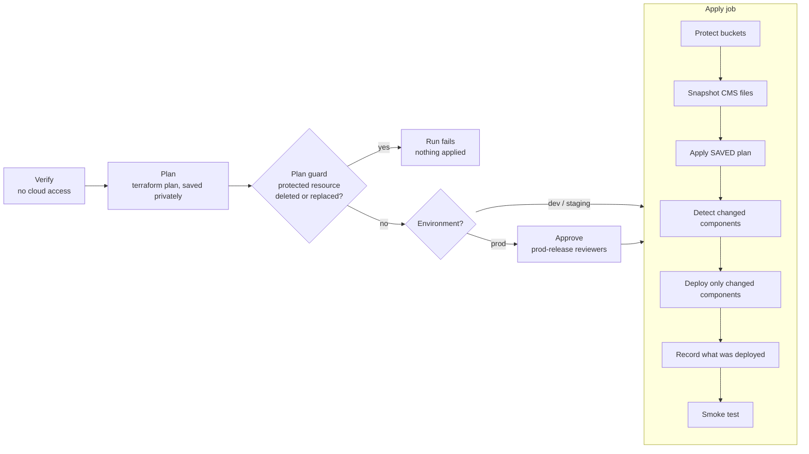

# Deployment

How Beatrix.ai is deployed to `dev`, `staging` and `prod`, why it is safe, and how to operate it.
Read this before you deploy, change a workflow, or change anything in `terraform/`.

- [1. What the pipeline guarantees](#1-what-the-pipeline-guarantees)
- [2. Environments and triggers](#2-environments-and-triggers)
- [3. The pipeline, stage by stage](#3-the-pipeline-stage-by-stage)
- [4. How unchanged things stay untouched](#4-how-unchanged-things-stay-untouched)
- [5. What the plan guard blocks](#5-what-the-plan-guard-blocks)
- [6. Security controls](#6-security-controls)
- [7. One-time setup](#7-one-time-setup)
- [8. Runbook: deploy to prod](#8-runbook-deploy-to-prod)
- [9. Runbook: roll back](#9-runbook-roll-back)
- [10. Runbook: restore data](#10-runbook-restore-data)
- [11. Break-glass: intentionally destructive changes](#11-break-glass-intentionally-destructive-changes)
- [12. Troubleshooting](#12-troubleshooting)
- [13. Limits and things not yet verified](#13-limits-and-things-not-yet-verified)
- [14. File map](#14-file-map)

Names: the three environments are called exactly `dev`, `staging` and `prod`, everywhere (workflow
inputs, GitHub environments, `terraform/environments/<env>.tfvars`, Terraform `environment`, scripts, docs).

## 1. What the pipeline guarantees

A deployment changes **only what the release changes**. Specifically:

| Thing | Guarantee |
|---|---|
| Firestore data (including `allowed_emails`) | Never deleted or replaced by a deploy. The database has delete protection, `prevent_destroy`, `ABANDON` on destroy and 7-day point-in-time recovery. A plan that would delete or replace it fails before anything is applied. |
| CMS files (`cms/profile.json`, `cms-backups/`) | Never written by a deploy. They are copied to a timestamped backup first, and both buckets keep old versions. |
| User resumes (`gs://<project>-resumes`, Firestore `resume_owners`, `resume_audit`) | Never written, deleted or snapshotted by a deploy. The bucket is protected like the other stateful resources and keeps old versions for 30 days (section 10.1b). The pre-deploy snapshot and `harden-buckets.sh` only handle the state and CMS buckets, so personal resume data is never copied into the state bucket. |
| Cloud Functions | Redeployed only when `functions/` (or the `functions` block of `firebase.json`) changed. The Firebase CLI is run **without** `--force`, so it refuses to delete a function that is missing from the source instead of deleting it. |
| Security rules | Redeployed only when `firestore.rules`, `storage.rules` or their `firebase.json` entries changed. |
| App Hosting site | A new rollout is created only when app source, dependencies or `apphosting.yaml` changed. |
| Terraform-managed infrastructure (IAM, buckets, service accounts, ...) | Terraform changes only resources whose configuration differs. Stateful resources cannot be destroyed or replaced by a normal deploy. |
| What gets applied | Exactly the plan that was reviewed (for prod: and approved). The saved plan is applied; nothing is re-planned. |

The guarantees come from several independent layers (Terraform settings, the plan guard, change
detection, a Firebase CLI without `--force`, backups). Section 13 lists what is **not** covered.

## 2. Environments and triggers

| Environment | GCP project | Deployed | Approval |
|---|---|---|---|
| `dev` | from `terraform/environments/dev.tfvars` | automatically on every push to `main` | none |
| `staging` | from `staging.tfvars` | automatically after `dev` succeeds | none |
| `prod` | `beatrix-ai-prod` (`prod.tfvars`) | **only** by a manual run of the Deploy workflow | typed confirmation + reviewers of the `prod-release` GitHub environment |

Automatic runs (`dev`, `staging`) use the same pipeline as prod, including the plan guard, so a
destructive change fails the run instead of being applied. Never add an automatic trigger for prod.

## 3. The pipeline, stage by stage

Entry point: `.github/workflows/deploy.yml` (inputs and triggers). The pipeline itself:
`.github/workflows/deploy-environment.yml`. One run per environment at a time (a second run waits).



### Stage 1: Verify (job `verify`)

Runs with **no cloud credentials**.

1. **Deployment policy.** Environment must be `dev`, `staging` or `prod`; the ref may only contain safe
   characters. For `prod`: the run must be manual, `confirm` must be `prod`, and the ref must be a
   `release/<major.minor[.patch]>` branch or a `v<major.minor.patch>` tag. Anything else stops here.
2. **Checkout** of the ref and **resolution to a commit SHA.** Every later job checks out that exact
   SHA, so what was verified and approved is what is deployed, even if the branch moves meanwhile.
3. `pnpm install --frozen-lockfile`, `npm run typecheck`, `npm run lint`, `npm run build`, build of the
   Cloud Functions.
4. `terraform fmt -check`, `terraform init -backend=false`, `terraform validate`.
5. Script checks: `bash -n` on the deployment scripts and the plan guard unit tests.

### Stage 2: Plan (job `plan`, GitHub environment = the target)

1. Reads the GitHub environment variables (`GCP_PROJECT_ID`, `GCP_WORKLOAD_IDENTITY_PROVIDER`,
   `GCP_DEPLOYER_SERVICE_ACCOUNT`, `TF_STATE_BUCKET`). An unprovisioned `dev`/`staging` is skipped with a
   notice; an unprovisioned `prod` **fails**, so a misconfiguration is never reported as success.
2. Signs in to Google Cloud with Workload Identity Federation (no keys).
3. `terraform plan -detailed-exitcode -out=tfplan -var-file=environments/<env>.tfvars`. Nothing is
   changed. The redacted plan is written to the job summary.
4. **Plan guard** (`scripts/deploy/plan_guard.py`), see section 5.
5. The binary plan is stored in the environment's private state bucket at
   `gs://<project>-tfstate/deploy/plans/<run>-<attempt>/tfplan` (not as a GitHub artifact, because a
   plan can contain values Terraform does not redact in JSON).

### Stage 3: Approve (job `approve`, prod only)

The job uses the GitHub environment `prod-release`. Its required reviewers are asked to approve. The
approval screen shows the commit and the ref; the plan is in the job summary of the same run. The job
has no cloud access and no token permissions. It exists only to hold the run until a person approves.

> The approval is only a real gate if `prod-release` has **required reviewers**. GitHub creates a missing
> environment with no protection, which would let the run through. Section 7 shows how to set it up
> and how to check it.

### Stage 4: Apply (job `apply`, GitHub environment = the target)

1. **Protect buckets** (`scripts/deploy/harden-buckets.sh`): turns on object versioning on the state
   bucket and the CMS bucket, and public access prevention on the state bucket, when missing. Adds
   retention for saved plans (7 days) and backups (90 days) and a "delete old versions after 90 days"
   rule only when the bucket has **no lifecycle configuration at all**. It only ever turns protection on.
2. **Snapshot the CMS files** (`scripts/deploy/backup-snapshot.sh`): copies `cms/` and `cms-backups/`
   from the CMS bucket to `gs://<project>-tfstate/backups/<UTC time>-<sha7>/storage/`. Read-only on the
   source. Skipped with a notice when there are no files yet.
3. **Terraform apply of the saved plan.** Terraform refuses a plan whose state changed since it was
   made, so nothing unreviewed can be applied. Skipped when the plan has no changes.
4. **Detect changed components** (`scripts/deploy/components.sh`): hashes the sources of `functions`,
   `rules` and `apphosting` and compares them with the marker recorded after the last successful deploy
   (`gs://<project>-tfstate/deploy/markers/<component>.json`). Unchanged components are skipped. With
   `redeploy_all` every component is deployed.
5. **Deploy only the changed components** (`scripts/deploy-backend.sh --components ...`), with the Firebase
   CLI pinned to an exact version and without `--force`.
6. **Record what was deployed.** Markers are written only after a successful deploy, so a failed deploy
   is retried by the next run.
7. **Smoke test** (`scripts/deploy/smoke-test.sh`): `GET /` returns 200 and HTML; `GET /api/admin/cms`
   without a token returns 401. Read-only.
8. **Summary:** what was applied, deployed or left untouched, the commit and the backup location.

### Deploy inputs (Actions > Deploy > Run workflow)

| Input | Meaning |
|---|---|
| `environment` | `dev`, `staging` or `prod` (default `dev`, so a careless click never targets prod) |
| `ref` | Branch, tag or commit SHA. Prod accepts only `release/x.y[.z]` or `vX.Y.Z` |
| `confirm` | Type `prod` to deploy prod |
| `allow_destructive` | **Dangerous.** Lets the plan delete/replace protected resources and lets removed functions be deleted. Section 11 |
| `redeploy_all` | Redeploy every component even if unchanged (for example to repair a component) |

## 4. How unchanged things stay untouched

| Layer | Mechanism | Detail |
|---|---|---|
| Terraform resources | Plan diff | Terraform only changes resources whose configuration or state differs. A no-op plan applies nothing. |
| Stateful resources | `prevent_destroy`, delete protection, plan guard | Firestore database, CMS bucket and App Hosting backend cannot be destroyed or replaced by a deploy. |
| Firestore documents | Not touched by deploys | The only documents Terraform manages are `allowed_emails/<email>` entries listed in `allowed_admin_emails`. Removing an email from the tfvars deletes that document, which the plan guard blocks unless `allow_destructive` is set. |
| User access data | Runtime-managed, deploys never write it | Users are registered on first sign-in (inside `sessionCreate`, role `reader`) and managed at `/admin/access` (role, revoke/restore). Only the seed admins in `allowed_admin_emails` are Terraform-managed: re-applying a changed seed document resets its `admin`/`allowed` fields, so manage everyone else in the panel. |
| CMS files | Not touched; backed up; versioned | The pipeline never writes `cms/`. Saves made through `/admin` keep working across deploys. `scripts/seed-data.sh` never overwrites an existing `cms/profile.json`. |
| User resumes | Not touched; versioned 30 days; protected bucket | `gs://<project>-resumes` (Terraform `resumes_storage`: `prevent_destroy`, `force_destroy = false`, versioning, noncurrent versions deleted after 30 days, public access prevention) and the Firestore `resume_owners` index are written only by the resume functions at runtime; a deploy never writes or deletes them. |
| Cloud Functions | Component hash + no `--force` | Skipped when `functions/` is unchanged. When it did change, the Firebase CLI deploys the codebase; it refuses (instead of deleting) functions that disappeared from the source. |
| Security rules | Component hash | Skipped when the rule files are unchanged. |
| App Hosting | Component hash | No new rollout when the app did not change. Existing rollouts are never deleted. |
| Configuration | Source of truth in git | `apphosting.yaml`, `firebase.json`, `terraform/` are changed only through reviewed PRs. Manual console changes show up as drift in the plan and are reverted, so make changes in git. |

Granularity: change detection is per **component** (functions, rules, App Hosting), not per individual
function. Changing one function redeploys the functions component; the Firebase CLI then decides per
function what to update.

## 5. What the plan guard blocks

`scripts/deploy/plan_guard.py` reads the saved plan (`terraform show -json`). It **fails the run** when a
resource of a protected type would be **deleted** or **replaced** (a replace deletes the old resource):

`google_firestore_database`, `google_firestore_document`, `google_storage_bucket`,
`google_firebase_app_hosting_backend`, `google_firebase_project`, `google_firebase_web_app`,
`google_service_account`, `google_iam_workload_identity_pool`,
`google_iam_workload_identity_pool_provider`, `google_firebaserules_release`.

Creates and in-place updates are allowed, as are deletes of other resource types (for example an IAM
binding or a rules ruleset version). The guard runs **before** approval and before apply. In addition,
Terraform itself refuses to destroy resources marked `prevent_destroy`. To pass the guard on purpose, see
section 11. Add a type to `PROTECTED_TYPES` (and a test in `scripts/deploy/test_plan_guard.py`) whenever
you add a new resource that holds data or identity.

## 6. Security controls

- **No long-lived keys.** CI signs in with Workload Identity Federation. The provider only accepts jobs of
  this repository running in the GitHub environment with the environment's name (`prod` for prod).
- **Least privilege per job.** Workflow `permissions` default to `contents: read`; only plan/apply get
  `id-token: write`; verify and approve have no cloud access; approve has no token permissions.
- **Pinned supply chain.** Third-party actions are pinned to full commit SHAs (with the version in a
  comment) and checked by `infra-check.yml`; Terraform, Node, pnpm and the Firebase CLI are pinned to
  exact versions; `.terraform.lock.hcl` pins the providers. Dependabot proposes action updates weekly.
- **No script injection.** Values an operator controls (`ref`, `confirm`) reach shell only through
  environment variables, never through `${{ }}` inside a script, and the ref is validated first.
- **What is verified is what is deployed.** One commit SHA is resolved once and used by every job.
- **No unreviewed apply, no `--force`.** `infra-check.yml` fails the build if a workflow contains
  `-auto-approve` or calls `firebase deploy --force` directly.
- **Prod gates.** Manual trigger only, typed confirmation, release ref only, environment protection on
  `prod`, and required reviewers on `prod-release`.
- **One deploy at a time per environment** (concurrency group), and Terraform state locking.
- **Private artifacts.** Saved plans, markers and backups live in the private, versioned,
  public-access-prevented state bucket; `terraform/tfplan` and `plan.json` are git-ignored.
- **Functions stay private.** Only the App Hosting service account can invoke them; admin functions also
  verify the Firebase ID token and require the `cms:write` permission (the `admin` role). Unchanged by this pipeline.

### Access control and roles

Every route except `/` (and the sign-in endpoint and static files) needs a server-verified session; the
gate is `src/proxy.ts`, backed by the private `sessionCreate` and `sessionVerify` functions. The full
description is in `CLAUDE.md` (Access control) and the spec `openspec/specs/access-control/`.

- **Roles** live in `allowed_emails/{email}.role`: `reader` (default when unset), `user-base`,
  `user-advanced`, `admin`. Entries seeded by Terraform with `admin: true` and no `role` are admins, so
  existing environments keep working. `allowed: false` removes access; deleting the document only resets the user to a new `reader` at their next sign-in.
- **First sign-in:** a verified Google account with no `allowed_emails/{email}` document is registered as a
  `reader` and signed in; `allowed: false` stays refused.
- **Promote or demote** at `/admin/access` (admins only; it refuses self-revoke, self-demote and removing the
  last active admin), or by editing the `role` field of the user's `allowed_emails/{email}` document in
  the Firebase console (Firestore). It takes effect on the user's next request, with no re-login.
  Terraform only manages the admin documents listed in `allowed_admin_emails`; do not set a different
  `role` on those by hand, since Terraform rewrites them on the next apply.
- **Emergency lock-out of one user:** set `allowed: false`, and optionally revoke their refresh tokens
  (`getAuth().revokeRefreshTokens(uid)` with the Admin SDK, or the console) so the session cookie dies too.
- **Deploy order:** the functions and App Hosting components are deployed by one `firebase deploy`, so
  their order is not guaranteed. This is safe: a new site without `sessionVerify` fails closed (protected
  routes redirect or return 503, `/` still works), and new functions with the old site change nothing
  visible. The smoke test's "`/api/admin/cms` without a token returns 401" now comes from the proxy and
  still holds.
- **Local development** uses the real functions through `FUNCTIONS_CALLER_SERVICE_ACCOUNT`; with no
  reachable functions the gate denies instead of letting everyone in.

## 7. One-time setup

Do this once before the first prod deploy. Steps marked **(you)** are manual by design.

### 7.1 Provision the environment

```bash
./scripts/recreate-environment.sh prod
```

It stops with an `ACTION REQUIRED` list for the manual steps (GCP project `beatrix-ai-prod`, billing,
Storage "Get started", Google sign-in provider, authorized domain). Do them in order, re-run until it
finishes. It creates the state bucket, plans and applies Terraform (with the plan guard), seeds
`cms/profile.json` only if absent, deploys, and writes the variables of the GitHub environment `prod`.
Full runbook: `terraform/README.md`.

> The Terraform changes in this pipeline (Firestore delete protection and point-in-time recovery, bucket
> versioning, `prevent_destroy`) are in-place updates on existing resources. The first plan after
> merging shows them for `dev` and `staging`; nothing is deleted. Point-in-time recovery stores 7 days of
> versions and adds a small storage cost.

### 7.2 GitHub environments **(you)**

Settings > Environments:

| Environment | Settings |
|---|---|
| `prod` | Deployment branches and tags: *Selected branches and tags* with `main`, `release/*` and the tag pattern `v*` (this restricts which ref the workflow may be run from). Variables are written by `recreate-environment.sh`, which only creates the environment when it is missing and never resets protection rules you set in the UI. No reviewers needed here (the approval happens in `prod-release`, so you are not asked twice). |
| `prod-release` | **Required reviewers: add yourself and anyone who may approve prod.** Deployment branches: same as `prod`. No variables or secrets. |
| `dev`, `staging` | Variables only (written by the script). |

With one maintainer, leave "Prevent self-review" off or you cannot approve your own deployment; with a
team, turn it on.

Check that the gate is real:

```bash
gh api repos/AbhirupGhosh92/beatrix.ai/environments/prod-release \
  --jq '.protection_rules[] | select(.type=="required_reviewers") | .reviewers[].reviewer.login'
```

It must print at least one login. An empty result means approvals are not enforced.

### 7.3 Repository settings **(you)**

- Branch protection on `main` (already on): require PRs and passing checks (`check-branch-name`,
  `Validate Infrastructure Code`).
- Protect release branches and tags: a ruleset for `release/*` and `v*` that blocks force-push and
  deletion, so a reviewed release cannot be rewritten.
- `CODEOWNERS` lists the owner as default reviewer for every path. To make that binding, enable *Require review from Code Owners* in the branch protection of `main`, so changes to `.github/workflows/`, `terraform/` and `scripts/` cannot merge without the owner.

### 7.4 After this change is merged

The workflow file is taken from the branch you run it from. Merge `main` into `release/*` branches
that must be deployable with this pipeline (for example `release/1.1.0`).

## 8. Runbook: deploy to prod

1. **Staging first.** The commit you intend to release must already be deployed to staging (every push to
   `main` does that) and pass the smoke test. Open staging and check the change by hand.
2. **Cut the release branch** from `main`: `release/<major.minor[.patch]>`. Bump `package.json` version.
   Open the release ticket with the standard format and release notes (`.claude/rules/github-workflow.md`).
3. **Run the workflow:** Actions > Deploy > Run workflow.
   - Use workflow from: `main` (or the release branch)
   - `environment`: `prod`; `ref`: `release/1.1.0`; `confirm`: `prod`
   - leave `allow_destructive` and `redeploy_all` off
4. **Review the plan.** Open the run, read the job summary of the `plan` job: counts, the table of changes
   and the plan text. A first prod deploy creates everything; later deploys should show few changes.
   Unexpected `delete`/`replace` lines mean stop: cancel the run and investigate.
5. **Approve.** The `approve` job waits on the `prod-release` reviewers. Approve only if the plan matches
   the release. Rejecting stops the run; nothing has been applied before this point.
6. **Watch the apply job.** It snapshots the CMS files, applies the saved plan, deploys changed
   components, records them and smoke-tests. The final job summary lists what was deployed and what was
   left untouched, plus the backup location.
7. **Verify by hand:** home page in both themes, sign-in, `/admin` list/open/save, the JSON editor theme.
8. **Close out:** tag `v<version>` on the deployed commit, publish the GitHub release with the notes, tick
   the release ticket. Merge the release branch back into `main` if it received any commits.

## 9. Runbook: roll back

Rolling back code is a normal deployment of an older ref. Data is **not** rolled back by it (see
section 10 for data).

1. **Code (functions, rules, site):** Run the Deploy workflow for `prod` with `ref` set to the previous
   release (`release/x.y` or `vX.Y.Z`) and `confirm` = `prod`. Change detection compares hashes, so every
   component whose sources differ from the current deploy is redeployed to the old version; the others are
   untouched. Use `redeploy_all` only to repair a component.
2. **Faster for the site only:** in the Firebase console (App Hosting > beatrix-web > Rollouts) roll back
   to the previous rollout. Then redeploy the old ref through the workflow so the markers match reality.
3. **Infrastructure:** the old ref's Terraform is planned against current state; read the plan as usual.
   Terraform will not recreate or delete protected resources (guard).
4. **Functions deleted by mistake** (only possible with `allow_destructive`): redeploy the ref that still
   contains them; functions are source-defined.

## 10. Runbook: restore data

### 10.1 CMS files (profile.json and the other `cms/` files)

Every `/admin` save already keeps the previous version under `cms-backups/`. Beyond that:

```bash
# a) An older version of one file (object versioning): list generations, then copy one back.
gcloud storage ls --all-versions gs://<project>.firebasestorage.app/cms/profile.json
gcloud storage cp 'gs://<project>.firebasestorage.app/cms/profile.json#<generation>' \
                  gs://<project>.firebasestorage.app/cms/profile.json

# b) The pre-deploy snapshot taken by the pipeline (path is in the deploy job summary).
gcloud storage ls gs://<project>-tfstate/backups/
gcloud storage cp --recursive gs://<project>-tfstate/backups/<time>-<sha>/storage/cms \
                  gs://<project>.firebasestorage.app/
```

Replace `<project>` with the GCP project id (for example `beatrix-ai-prod`).

### 10.1b User resumes (deleted or overwritten in the last 30 days)

Resumes live in `gs://<project>-resumes/owners/<sha256 of the owner email>/<resume id>.json`. Deleting or
overwriting one keeps the previous version for 30 days; there is no restore button, an operator restores it:

```bash
# the owner folder is the sha256 of the lowercase email
printf '%s' 'person@example.com' | sha256sum
gcloud storage ls --all-versions gs://<project>-resumes/owners/<hash>/
# copy the wanted generation back as the live object
gcloud storage cp 'gs://<project>-resumes/owners/<hash>/<id>.json#<generation>' \
                  gs://<project>-resumes/owners/<hash>/<id>.json
```

After restoring a deleted resume, correct that owner's `resume_owners/<email>` document (`count`) in
Firestore so the cap counts it.

**Revoked users keep their data.** Revoking access never deletes resumes; restoring access returns them
unchanged. `/admin/access` shows a "Resume data without access" table (functions `adminListResumeOwners`
and `adminPurgeResumeOwner`, `cms:write` only) listing owners whose access is revoked or whose
`allowed_emails` entry is gone, with email, resume count, size and last change, never any content.
Its **Delete data** button is a **hard delete**: after the admin types the owner's email it removes every
stored version of every resume of that owner, so the 30-day recovery above does not apply to it. The
functions refuse an owner who still has access, delete nothing when the typed email does not match, and
record each purge (admin, owner, time, number of files) in the Firestore collection `resume_audit`.
These routes are not tied to the `resume-builder` menu flag, so orphaned data stays removable while the
feature is switched off.

### 10.2 Firestore (point-in-time recovery, last 7 days)

Point-in-time recovery lets you read or export the database as it was at any minute in the last 7 days.
Export that moment to a bucket, then import it into a **new** database (never over the live one) and copy
what you need back:

```bash
# Run `gcloud firestore export --help` first: flags can change between gcloud versions.
gcloud firestore export gs://<project>-tfstate/backups/firestore-restore \
  --snapshot-time=2026-11-02T09:00:00Z --project=<project>
gcloud firestore databases create --database=restore-check --location=<location> --project=<project>
gcloud firestore import gs://<project>-tfstate/backups/firestore-restore/<export-folder> \
  --database=restore-check --project=<project>
```

The only Firestore data today is `allowed_emails/<email>`, which Terraform recreates from
`allowed_admin_emails`; a fresh `terraform apply` through the pipeline restores admin access without any
import. For a full backup beyond 7 days, run a manual `gcloud firestore export` before risky work.

### 10.3 Terraform state

The state bucket is versioned. To restore a previous state file, list versions with
`gcloud storage ls --all-versions gs://<project>-tfstate/terraform/state/default.tfstate` and copy a
generation back. Do this only when the state is corrupted, and never while a deploy is running.

## 11. Break-glass: intentionally destructive changes

Some changes are legitimately destructive: deleting a function you removed from the source, removing an
admin email, or replacing a bucket. The plan guard and the Firebase CLI refuse them by default. To do one:

1. Write down what will be removed and why in the ticket; confirm a restore path exists (section 10).
2. Take a manual backup if the data matters (`gcloud firestore export`, `gcloud storage cp --recursive`).
3. For a resource with `prevent_destroy`, change the Terraform in a reviewed PR first: remove the
   `lifecycle { prevent_destroy = true }` block (and, for Firestore, set `delete_protection_state` to
   `DELETE_PROTECTION_DISABLED`) in its own commit, deploy that, then make the destructive change.
4. Run the Deploy workflow with `allow_destructive` checked. The guard prints a **WARNING** listing every
   protected resource that will go. For prod the reviewers see the same plan.
5. Put the protection back in a follow-up PR.

Never use `allow_destructive` to "make a failing run pass". Read the guard message first.

## 12. Troubleshooting

| Symptom | Cause and fix |
|---|---|
| Run fails in `verify` with "prod is only deployed from release/..." | The `ref` is not a release branch or `vX.Y.Z` tag. Cut a release branch (section 8). |
| "To deploy prod, type prod in the 'confirm' input" | Type `prod` in `confirm`. |
| Plan guard: `BLOCKED ... would delete/replace protected resource` | A Terraform change would destroy data or identity. Read the resource address in the summary, fix the change (often an accidental rename or a changed immutable argument such as a location). Only use section 11 if it is intended. |
| `Instance cannot be destroyed` from Terraform | `prevent_destroy` caught it. Same as above. |
| `Saved plan is stale` | State changed between plan and apply (another apply, or manual change). Re-run; a new plan is made. |
| `Error acquiring the state lock` | Another run or a crashed run holds the lock. Wait; if no deploy is running, `terraform force-unlock <id>` from a trusted machine. |
| Firebase CLI refuses: functions would be deleted | A function exists in the project but not in the source (renamed or removed). Restore it in the source, or follow section 11 if the removal is intended. |
| Firebase CLI stops asking for confirmation in non-interactive mode | Run the failing command locally to see the prompt; if it is the artifact cleanup policy, `firebase functions:artifacts:setpolicy --project <project>` once. |
| `approve` never appears or passes instantly | `prod-release` has no required reviewers. Fix section 7.2 and re-run. |
| Smoke test fails right after deploy | The new rollout may still be starting (it retries for about a minute). If it persists, roll back (section 9) and check the App Hosting logs. |
| Components are redeployed that did not change | The marker is missing (first deploy of that environment) or `redeploy_all` was set. Markers live in `gs://<project>-tfstate/deploy/markers/`. |
| Component keeps deploying although unchanged | The last deploy failed before the marker was written. A successful run fixes it. |
| `GitHub environment 'prod' has no GCP variables` | Run `./scripts/recreate-environment.sh prod` (writes the variables). |

## 13. Limits and things not yet verified

Be aware of these; none of them is hidden by the pipeline:

- **Not exercised end to end.** The pipeline was written and statically checked (YAML, shell syntax, plan
  guard unit tests, hash behaviour, pin and injection checks), but a real run against GCP was not done
  before it was merged. Run it on `dev`, then `staging`, and read the job summaries before relying on it
  for prod. `terraform validate` runs in CI because the Terraform registry was not reachable where it
  was authored. `actionlint` was not run.
- **Component granularity.** Change detection is per component, not per function (section 4).
- **gcloud output fields.** `scripts/deploy/harden-buckets.sh` reads bucket settings as JSON and accepts
  both spellings gcloud and the API use; a failed read stops the run instead of being treated as
  "unset", and an existing lifecycle configuration is never replaced. The exact field names were not
  exercised against a real bucket.
- **Firebase CLI prompts.** Without `--force`, a non-interactive deploy relies on the CLI failing safely
  instead of prompting. The behaviour of the artifact cleanup prompt on a first functions deploy was not
  tested; see the troubleshooting row.
- **Firestore backups.** Point-in-time recovery covers 7 days. Longer-term exports are manual.
- **Drift is reverted.** Terraform reverts manual console changes to managed resources. Admin documents
  `allowed_emails/<email>` managed by Terraform are rewritten with `admin: true, allowed: true`.
- **Rules have two writers.** Terraform manages rulesets/releases and `firebase deploy` also publishes
  rules. Both come from the same files in git, so they agree.
- **Bucket naming.** The CMS files live in the default Firebase Storage bucket
  (`<project>.firebasestorage.app`), which Firebase creates; the Terraform-managed `<project>-cms-<env>`
  bucket is currently unused by the code but protected the same way. The Terraform-managed
  `<project>-resumes` bucket **is** used (by the resume functions) and its name is derived from the project
  id in `functions/src/firebase.ts`, so the two must stay in step.
- **Resume builder: dev run reported, not itemised.** The resume functions, bucket rules and admin cleanup
  were built against in-memory models of Firestore and Storage and in a headless browser, then run on `dev`
  by the owner, who reported that it works. The per-case results were not recorded. The checklist is
  `openspec/changes/archive/2026-10-30-resume-builder/verification.md`; the cases worth repeating before
  the first prod deploy are the Terraform plan for the new bucket, the admin purge deleting every object
  version, restoring a deleted resume, and the 30-day lifecycle rule. Opening the DOCX in Microsoft Word was
  not tested by the author. The functions' runtime service account reaches the new bucket through the same
  project-wide access it uses for the CMS bucket; no explicit IAM binding was added for it.
- **Resume restores are manual.** There is no restore button; an operator restores a deleted resume from
  its noncurrent version (section 10.1b). An admin's purge is a hard delete and cannot be restored.
- **Single maintainer.** Without a second reviewer, "approval" is the owner confirming their own
  deploy. The plan, the typed confirmation and the release-ref rule still apply.

## 14. File map

| Path | Purpose |
|---|---|
| `.github/workflows/deploy.yml` | Triggers and inputs (push to `main` -> dev, staging; manual -> any) |
| `.github/workflows/deploy-environment.yml` | The pipeline: verify, plan, approve, apply |
| `.github/workflows/infra-check.yml` | PR checks: terraform fmt/validate, script tests, SHA pins, no `-auto-approve`/`--force` |
| `.github/dependabot.yml` | Weekly proposals to update pinned actions |
| `scripts/deploy/plan_guard.py`, `test_plan_guard.py` | Blocks destroy/replace of protected resources, with tests |
| `scripts/deploy/components.sh` | Component hashes, changed detection, markers |
| `scripts/deploy/harden-buckets.sh` | Turns on versioning, public access prevention and retention |
| `scripts/deploy/backup-snapshot.sh` | Pre-deploy copy of the CMS files |
| `scripts/deploy/smoke-test.sh` | Post-deploy read-only checks |
| `scripts/deploy-backend.sh` | Deploys the selected components, no `--force` unless `--allow-destructive` |
| `scripts/recreate-environment.sh` | Provision or repair an environment (plan, guard, apply) |
| `functions/src/resumes.ts`, `resumeAdmin.ts` | Resume storage, cap and ownership; admin list and purge of data left by revoked users |
| `terraform/` | Infrastructure, including the data protections (CMS bucket, resumes bucket) |
| `terraform/README.md` | Environment provisioning runbook |

## GitHub releases

Pushing a `release/<major.minor[.patch]>` branch runs `.github/workflows/release.yml`, which tags `vX.Y.Z` and publishes a GitHub release marked Latest using `RELEASE_NOTES.md` from that branch. It does not deploy anything; deployment stays as described above. The site shows the latest release version and notes in a modal at the bottom of the page.
