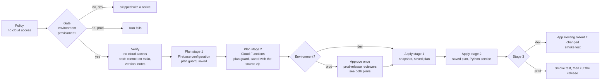

# Deployment

How Beatrix.ai is deployed to `dev` and `prod`, why it is safe, and how to operate it.
Read this before you deploy, change a workflow, or change anything in `terraform/`.

- [1. What the pipeline guarantees](#1-what-the-pipeline-guarantees)
- [2. Environments and triggers](#2-environments-and-triggers)
- [3. The pipeline, stage by stage](#3-the-pipeline-stage-by-stage)
- [4. How unchanged things stay untouched](#4-how-unchanged-things-stay-untouched)
- [5. What the plan guard blocks](#5-what-the-plan-guard-blocks)
- [6. Security controls](#6-security-controls)
- [7. One-time setup](#7-one-time-setup)
- [8. Runbook: deploy to prod](#8-runbook-deploy-to-prod)
- [9. Runbook: roll back](#9-runbook-roll-back)
- [10. Runbook: restore data](#10-runbook-restore-data)
- [11. Break-glass: intentionally destructive changes](#11-break-glass-intentionally-destructive-changes)
- [12. Troubleshooting](#12-troubleshooting)
- [13. Limits and things not yet verified](#13-limits-and-things-not-yet-verified)
- [14. File map](#14-file-map)

Names: the two environments are called exactly `dev` and `prod`, everywhere (workflow
inputs, GitHub environments, `terraform/environments/<env>.tfvars`, Terraform `environment`, scripts, docs).

## 1. What the pipeline guarantees

A deployment changes **only what the release changes**. Specifically:

| Thing | Guarantee |
|---|---|
| Firestore data (including `allowed_emails`) | Never deleted or replaced by a deploy. The database has delete protection, `prevent_destroy`, `ABANDON` on destroy and 7-day point-in-time recovery. A plan that would delete or replace it fails before anything is applied. |
| CMS files (`cms/profile.json`, `cms-backups/`) | Never written by a deploy. They are copied to a timestamped backup first, and both buckets keep old versions. |
| User resumes and job applications (`gs://<project>-resumes`, Firestore `resume_owners`, `application_owners`, `resume_audit`) | Never written, deleted or snapshotted by a deploy. The bucket is protected like the other stateful resources and keeps old versions for 30 days (section 10.1b). The pre-deploy snapshot and `harden-buckets.sh` only handle the state and CMS buckets, so personal resume data is never copied into the state bucket. Job applications are Firestore documents under `application_owners/<email>/applications`, so they are covered by the database protections above (delete protection, 7-day point-in-time recovery) and are never written by a deploy. |
| Cloud Functions | Terraform resources (`terraform/functions/functions.tf`, stage 2), changed only when the reviewed plan shows a difference. The source zip is named by its content hash, so unchanged code gives no diff and no new revision. A delete or replace of a function fails the plan guard. Each function is invokable only by `firebase-app-hosting-compute` (authoritative binding). The Firebase CLI never deploys them. |
| Security rules | Terraform resources (`google_firebaserules_*`, stage 1), changed only when the plan shows a difference. The Firebase CLI never deploys them. |
| App Hosting site | A new rollout is created only when app source, dependencies or `apphosting.yaml` changed. |
| Python AI service (Cloud Run `beatrix-ai`) | Redeployed only when `ai_backend/` changed (component `python`). Private: no unauthenticated access, only `firebase-app-hosting-compute` holds `roles/run.invoker`. The model API key is the Secret Manager secret `model-api-key`; Terraform creates it empty and only the runtime account `python-ai-runtime` can read it. You add the value yourself (`gcloud secrets versions add model-api-key --data-file=-`, see `ai_backend/README.md`), so it never reaches state, logs or the pipeline; the deploy mounts it only when a version exists. |
| Terraform-managed infrastructure (IAM, buckets, service accounts, ...) | Terraform changes only resources whose configuration differs. Stateful resources cannot be destroyed or replaced by a normal deploy. |
| What gets applied | Exactly the plan that was reviewed (for prod: and approved). The saved plan is applied; nothing is re-planned. |

The guarantees come from several independent layers (Terraform settings, the plan guard, change
detection, the Terraform plan for functions and rules, backups). Section 13 lists what is **not** covered.

## 2. Environments and triggers

Dev and prod are **separate deployments**: two workflows, two GitHub environments, two GCP projects, two states, and a concurrency group per environment, so neither can start, block or target the other (`scripts/check-pipelines.sh` fails CI if that changes). Both run the same three stages in the same order:

| Environment | GCP project | Pipeline | Started | Approval |
|---|---|---|---|---|
| `dev` | from `terraform/environments/dev.tfvars` | `deploy-dev.yml` | automatically on every merge (push) to `main`; by hand for another ref with `./scripts/deploy-dev.sh` or *Run workflow* | none |
| `prod` | `asterion-453905` (`prod.tfvars`) | `deploy-prod.yml` | **only** by hand: `./scripts/deploy-prod.sh <version>` (a terminal, or the agent after your yes) or *Run workflow* | typed confirmation + one approval by the reviewers of the `prod-release` GitHub environment |

| Stage | What it applies | Dev | Prod |
|---|---|---|---|
| 1 Firebase configuration | `terraform/`: APIs, Firestore, Storage, security rules, Auth, IAM, the App Hosting backend resource | yes | yes |
| 2 Cloud Functions | `terraform/functions/`: the Node functions; then the Python service (`gcloud run deploy`) when `ai_backend/` changed | yes | yes |
| 3 | dev: the App Hosting rollout (Firebase CLI) when the app changed. prod: **cut the release** | app | release |

Everything is applied by Terraform and GitHub Actions; the App Hosting rollout and the Python Cloud Run
deploy cannot be Terraform resources, so they are CLI steps inside Actions. A stage starts only after the
previous one succeeded. Automatic runs (`dev`) use the same stages and the same plan guards as prod, so a
destructive change fails the run instead of being applied. Never add an automatic trigger for prod.

**Prod takes a commit on `main` and a version.** `ref` (default `main`) must be reachable from `main`, and
`version` (`X.Y` or `X.Y.Z`) is required, with `confirm` = `prod`. Prod never deploys App Hosting: create
the rollout by hand in the Firebase console. After stages 1 and 2 and the smoke test succeed, the release
is cut at the deployed commit: the branch `release/<version>`, the tag `v<version>` and the GitHub release
(section "GitHub releases").

## 3. The pipeline, stage by stage

Entry points: `.github/workflows/deploy-dev.yml` (push to `main`, or by hand) and
`.github/workflows/deploy-prod.yml` (by hand). Both call `.github/workflows/deploy-environment.yml`, which
holds the jobs once; prod then calls `.github/workflows/release.yml` for stage 3. One run per environment
at a time (a second run waits).



**Reading a run.** Every step prints its inputs, what it decided and why, and its result, in four line
kinds (format in `scripts/deploy/log.sh`):

| Line | Meaning |
|---|---|
| `[step]` | the step is starting (also a fold-able group in the Actions log) |
| `[info]` | an input or a fact the step relies on (project, bucket, hashes) |
| `[decision]` | what the step decided **and why** (for example `python: unchanged, will not be touched`) |
| `[result]` | what actually happened |

A failure names the step and the next action to take. The run summary shows both Terraform plans, a table
of what this run changes (one row per stage: stage 1 and stage 2 from their plans; the Python service and
App Hosting each with the last deployed hash, the hash of this commit, the action and the reason), how far
each stage got and where the CMS backup went, if one was taken.

### Policy (job `policy`)

No checkout, no GitHub environment, no credentials. Environment must be `dev` or `prod`; the ref may only
contain safe characters. For `prod`: the run must be manual, `confirm` must be `prod` and `version` must
be `X.Y` or `X.Y.Z`. Anything else stops here. It runs before anything reads an environment, so an unknown
environment name can never create one.

### Gate (job `gate`)

Reads the GitHub environment variables (`GCP_PROJECT_ID`, `TF_STATE_BUCKET`) and nothing else: no
checkout, no credentials. An unprovisioned `dev` is skipped with a notice, before any build; an
unprovisioned `prod` **fails**, so a misconfiguration is never reported as success.

### Verify (job `verify`)

Runs with **no cloud credentials**.

1. **Checkout** of the ref and **resolution to a commit SHA.** Every later job checks out that exact
   SHA, so what was verified and approved is what is deployed, even if the branch moves meanwhile.
2. **Prod preflight** (`scripts/deploy/check-prod-ref.sh`, prod only, before any plan): the commit is
   reachable from `main`; `RELEASE_NOTES.md` exists and is non-empty at that commit; the branch
   `release/<version>` and the tag `v<version>` do not already exist at a *different* commit (the same
   commit is fine, a re-run updates its release). It reads the refs that the checkout fetched, so it needs
   no credentials.
3. `pnpm install --frozen-lockfile`, `npm run typecheck`, `npm run lint`, `npm run build`, build of the
   Cloud Functions.
4. `terraform fmt -check -recursive`, then `init -backend=false` and `validate` for **both** stages
   (`terraform/` and `terraform/functions/`).
5. Script checks (`scripts/check-scripts.sh`): `bash -n` on every shell script, the check that the function
   list in `terraform/functions/functions.tf` equals the exports of `functions/src/index.ts`, the check that
   both stages agree on project and environment, and the unit tests (plan guard, prod preflight, cut
   release). The same script runs in pull request checks and in `infra-check.yml`.

### Plan stage 1 and plan stage 2 (jobs `plan1`, `plan2`, GitHub environment = the target)

Both plans are made **before** any approval and nothing is applied.

1. Sign in to Google Cloud with Workload Identity Federation (no keys).
2. **Stage 1:** `terraform plan -detailed-exitcode -out=tfplan -var-file=environments/<env>.tfvars` in
   `terraform/`, then the **plan guard** (`scripts/deploy/plan_guard.py`, section 5). The summary lists
   each resource that would change; the full redacted plan is folded below.
3. **Stage 2:** `scripts/build-functions.sh` builds the function source (compiled `lib/`, `package.json`
   and the pnpm files in `terraform/functions/.build/functions-src`, with fixed file times), then the same
   plan and plan guard in `terraform/functions/` with `environments/<env>.tfvars`.
4. **Decide what to deploy.** The stage rows come from the plans (resources that change, or "not
   touched"). `scripts/deploy/components.sh status` hashes the sources of `python` (`ai_backend/`) and
   `apphosting` and compares them with the marker recorded after the last successful deploy
   (`gs://<project>-tfstate/deploy/markers/<component>.json`). With `redeploy_all` every component is
   marked changed. On `prod` App Hosting is never deployed by the pipeline (the table says to create the
   rollout by hand). The result is the decision table, and the apply jobs deploy exactly the components
   in it.
5. Each binary plan is stored in the environment's private state bucket at
   `gs://<project>-tfstate/deploy/plans/<run>-<attempt>/stage1/tfplan` and `.../stage2/tfplan`, with the
   function source zip beside the stage-2 plan (`stage2/functions.zip`). Apply downloads them and never
   rebuilds the zip. They are not GitHub artifacts, because a plan can contain values Terraform does not
   redact in JSON.

### Approve (job `approve`, prod only)

The job uses the GitHub environment `prod-release`. Its required reviewers are asked to approve **once**,
after both plans exist. The approval screen shows the commit, the ref and the version; the two plans and
the decision table (what will deploy and what will not be touched) are in the job summary of the same
run, so the reviewer approves a known set of changes. The job has no cloud access and no token
permissions. It exists only to hold the run until a person approves. If either plan guard blocks, the run
fails before this point and no approval is requested.

> The approval is only a real gate if `prod-release` has **required reviewers**. GitHub creates a missing
> environment with no protection, which would let the run through. Section 7 shows how to set it up
> and how to check it.

### Apply stage 1 (job `apply1`, GitHub environment = the target)

1. **Protect buckets** (`scripts/deploy/harden-buckets.sh`): turns on object versioning on the state
   bucket and the CMS bucket, and public access prevention on the state bucket, when missing. Adds
   retention for saved plans (7 days) and backups (90 days) and a "delete old versions after 90 days"
   rule only when the bucket has **no lifecycle configuration at all**. It only ever turns protection on
   and writes nothing when protection is already in place.
2. **Snapshot the CMS files** (`scripts/deploy/backup-snapshot.sh`): copies `cms/` and `cms-backups/`
   from the CMS bucket to `gs://<project>-tfstate/backups/<UTC time>-<sha7>/storage/`. Read-only on the
   source. **Only taken when a plan has changes or a component will deploy**; a run with nothing to
   change writes no backup. Skipped with a notice when there are no files yet.
3. **Terraform apply of the saved stage-1 plan.** Terraform refuses a plan whose state changed since it
   was made, so nothing unreviewed can be applied. Skipped when the plan has no changes.

### Apply stage 2 (job `apply2`)

1. **Terraform apply of the saved stage-2 plan** with the saved function source zip (functions, source
   object, invoker bindings). Skipped when the plan has no changes.
2. **The Python service** (`scripts/deploy-backend.sh --components python`, `gcloud run deploy`), only when
   `ai_backend/` changed, then its marker is recorded. On prod this runs after the approved apply, under
   the same approval.

### Stage 3 (job `stage3`, then `release.yml` on prod)

- **dev:** the App Hosting rollout (`scripts/deploy-backend.sh --components apphosting`, Firebase CLI
  pinned to an exact version) only when the app sources changed; the marker is recorded after success.
- **both:** the smoke test (`scripts/deploy/smoke-test.sh`): `GET /` returns 200 and HTML;
  `GET /api/admin/cms` without a token returns 401. Read-only.
- **prod:** no App Hosting deploy. After the smoke test, `deploy-prod.yml` calls `release.yml`, which cuts
  the release (section "GitHub releases"). A run that failed at any stage cuts nothing.
- **Summary** (job `summary`, always): the decision table, how far each stage got, the commit and the
  backup location, if one was taken.

### Pull request checks (`ci.yml`)

Pull requests to `main` run typecheck, lint, build, the functions build and `scripts/check-scripts.sh`,
without cloud access, so a failing change is rejected before it reaches `main` and the dev deploy.

### Deploy skills

Two agent skills run the pipelines and narrate them: `dev-deploy` (a pushed branch or commit to dev) and
`prod-deploy` (a commit on `main` to prod with a version; it refuses a ref that is not on `main`, a dirty or
unpushed tree, asks for an explicit yes in chat, and never approves `prod-release` itself).

### Pipeline inputs (Actions > Deploy dev / Deploy prod > Run workflow)

| Input | Dev | Prod | Meaning |
|---|---|---|---|
| `ref` | yes (default `main`) | yes (default `main`) | Branch, tag or commit SHA. Prod accepts only a commit reachable from `main` |
| `version` | | required | `X.Y` or `X.Y.Z`; the branch `release/<version>`, the tag and the GitHub release are cut with it after success |
| `confirm` | | required | Type `prod` |
| `allow_destructive` | yes | yes | **Dangerous.** Lets a plan delete or replace protected resources, functions included. Section 11 |
| `redeploy_all` | yes | yes | Redeploy every component even if unchanged (for example to repair a component) |

## 4. How unchanged things stay untouched

| Layer | Mechanism | Detail |
|---|---|---|
| Terraform resources | Plan diff | Terraform only changes resources whose configuration or state differs. A no-op plan applies nothing. |
| Stateful resources | `prevent_destroy`, delete protection, plan guard | Firestore database, CMS bucket and App Hosting backend cannot be destroyed or replaced by a deploy. |
| Firestore documents | Not touched by deploys | The only documents Terraform manages are `allowed_emails/<email>` entries listed in `allowed_admin_emails`. Removing an email from the tfvars deletes that document, which the plan guard blocks unless `allow_destructive` is set. |
| User access data | Runtime-managed, deploys never write it | Users are registered on first sign-in (inside `sessionCreate`, role `reader`) and managed at `/admin/access` (role, revoke/restore). Only the seed admins in `allowed_admin_emails` are Terraform-managed: re-applying a changed seed document resets its `admin`/`allowed` fields, so manage everyone else in the panel. |
| CMS files | Not touched; backed up; versioned | The pipeline never writes `cms/`. Saves made through `/admin` keep working across deploys. `scripts/seed-data.sh` never overwrites an existing `cms/profile.json`. |
| User resumes | Not touched; versioned 30 days; protected bucket | `gs://<project>-resumes` (Terraform `resumes_storage`: `prevent_destroy`, `force_destroy = false`, versioning, noncurrent versions deleted after 30 days, public access prevention) and the Firestore `resume_owners` index are written only by the resume functions at runtime; a deploy never writes or deletes them. Job applications (`application_owners/<email>/applications`, written only by the `application*` functions) follow the Firestore rows above: no new bucket, rule, Terraform resource or deploy component is involved, and they deploy with the `functions` component. |
| Cloud Functions | Terraform plan + content-hashed source | A function whose code did not change has the same source object, so the plan shows nothing for it. A function removed from the source and `terraform/functions/functions.tf` is a delete that the plan guard blocks. |
| Security rules | Terraform plan | Changed only when the rules files change the Terraform resources. |
| App Hosting | Component hash | No new rollout when the app did not change. Existing rollouts are never deleted. |
| Python AI service | Component hash + protected secret | No new Cloud Run revision when `ai_backend/` did not change. The secret `model-api-key` is a `PROTECTED_TYPES` resource (`prevent_destroy`), so a plan cannot delete it. |
| Configuration | Source of truth in git | `apphosting.yaml`, `firebase.json`, `terraform/` are changed only through reviewed PRs. Manual console changes show up as drift in the plan and are reverted, so make changes in git. |

Granularity: change detection for App Hosting and the Python service is per **component**. Functions and rules
are Terraform resources, so the plan shows exactly which function changes; changing one function changes
the shared source object, and with it every function's build source, so every function builds a new
revision when any function's code changes.

## 5. What the plan guard blocks

`scripts/deploy/plan_guard.py` reads the saved plan (`terraform show -json`). It **fails the run** when a
resource of a protected type would be **deleted** or **replaced** (a replace deletes the old resource):

`google_firestore_database`, `google_firestore_document`, `google_storage_bucket`,
`google_firebase_app_hosting_backend`, `google_firebase_project`, `google_firebase_web_app`,
`google_service_account`, `google_iam_workload_identity_pool`,
`google_iam_workload_identity_pool_provider`, `google_firebaserules_release`,
`google_secret_manager_secret`, `google_cloudfunctions2_function`.

Creates and in-place updates are allowed, as are deletes of other resource types (for example an IAM
binding or a rules ruleset version). The guard runs **before** approval and before apply. In addition,
Terraform itself refuses to destroy resources marked `prevent_destroy`. To pass the guard on purpose, see
section 11. Add a type to `PROTECTED_TYPES` (and a test in `scripts/deploy/test_plan_guard.py`) whenever
you add a new resource that holds data or identity.

## 6. Security controls

- **No long-lived keys.** CI signs in with Workload Identity Federation. The provider only accepts jobs of
  this repository running in the GitHub environment with the environment's name (`prod` for prod).
- **Least privilege per job.** Workflow `permissions` default to `contents: read`; only plan/apply get
  `id-token: write`; verify and approve have no cloud access; approve has no token permissions.
- **Pinned supply chain.** Third-party actions are pinned to full commit SHAs (with the version in a
  comment) and checked by `infra-check.yml`; Terraform, Node, pnpm and the Firebase CLI are pinned to
  exact versions; `.terraform.lock.hcl` pins the providers. Dependabot proposes action updates weekly.
- **No script injection.** Values an operator controls (`ref`, `confirm`) reach shell only through
  environment variables, never through `${{ }}` inside a script, and the ref is validated first.
- **What is verified is what is deployed.** One commit SHA is resolved once and used by every job.
- **No unreviewed apply, no `--force`.** `infra-check.yml` fails the build if a workflow contains
  `-auto-approve` or calls `firebase deploy --force` directly, and no workflow targets single resources.
- **Prod gates.** Manual trigger only, typed confirmation, a version, a commit that is on `main`,
  environment protection on `prod`, and one approval by the required reviewers of `prod-release` after
  both plans.
- **One deploy at a time per environment** (concurrency group), and Terraform state locking.
- **Private artifacts.** Saved plans, markers and backups live in the private, versioned,
  public-access-prevented state bucket; `terraform/tfplan` and `plan.json` are git-ignored.
- **Functions stay private.** Only the App Hosting service account can invoke them; admin functions also
  verify the Firebase ID token and require the `cms:write` permission (the `admin` role). Unchanged by this pipeline.

### Access control and roles

Every route except `/` (and the sign-in endpoint and static files) needs a server-verified session; the
gate is `src/proxy.ts`, backed by the private `sessionCreate` and `sessionVerify` functions. The full
description is in `CLAUDE.md` (Access control) and the spec `openspec/specs/access-control/`.

- **Roles** live in `allowed_emails/{email}.role`: `reader` (default when unset), `user-base`,
  `user-advanced`, `admin`. Entries seeded by Terraform with `admin: true` and no `role` are admins, so
  existing environments keep working. `allowed: false` removes access; deleting the document only resets the user to a new `reader` at their next sign-in.
- **First sign-in:** a verified Google account with no `allowed_emails/{email}` document is registered as a
  `reader` and signed in; `allowed: false` stays refused.
- **Promote or demote** at `/admin/access` (admins only; it refuses self-revoke, self-demote and removing the
  last active admin), or by editing the `role` field of the user's `allowed_emails/{email}` document in
  the Firebase console (Firestore). It takes effect on the user's next request, with no re-login.
  Terraform only manages the admin documents listed in `allowed_admin_emails`; do not set a different
  `role` on those by hand, since Terraform rewrites them on the next apply.
- **Emergency lock-out of one user:** set `allowed: false`, and optionally revoke their refresh tokens
  (`getAuth().revokeRefreshTokens(uid)` with the Admin SDK, or the console) so the session cookie dies too.
- **Deploy order:** the functions are applied by Terraform before App Hosting is deployed (dev), so the
  functions are ready first. Either order is safe: a new site without `sessionVerify` fails closed (protected
  routes redirect or return 503, `/` still works), and new functions with the old site change nothing
  visible. The smoke test's "`/api/admin/cms` without a token returns 401" now comes from the proxy and
  still holds.
- **Local development** uses the real functions through `FUNCTIONS_CALLER_SERVICE_ACCOUNT`; with no
  reachable functions the gate denies instead of letting everyone in.
- **AI service URL.** The site's server reaches the private `beatrix-ai` Cloud Run service (source:
  `ai_backend/`) through `src/middleware/aiService.ts`, which reads `AI_BACKEND_URL`. Its value per
  environment is that service's URL (`gcloud run services describe beatrix-ai --project <project> --region
  us-central1 --format 'value(status.url)'`), set as an environment variable on the App Hosting backend.
  It is not a secret and it is not yet set by the pipeline. While it is unset, the resume workspace's AI
  actions answer 503 ("not configured") and the rest of the site is unaffected. Locally, run the service
  (`ai_backend/README.md`) and point `AI_BACKEND_URL` at it with `FUNCTIONS_CALLER_SERVICE_ACCOUNT` set,
  or deploy to dev and use its URL.

## 7. One-time setup

Do this once before the first prod deploy. Steps marked **(you)** are manual by design.

### 7.1 Provision the environment

```bash
./scripts/recreate-environment.sh prod
```

It stops with an `ACTION REQUIRED` list for the manual steps (GCP project `asterion-453905`, billing,
Storage "Get started", Google sign-in provider, authorized domain). Do them in order, re-run until it
finishes. It creates the state bucket, plans and applies Terraform (with the plan guard), seeds
`cms/profile.json` only if absent, deploys, and writes the variables of the GitHub environment `prod`.
Full runbook: `terraform/README.md`.

> The Terraform changes in this pipeline (Firestore delete protection and point-in-time recovery, bucket
> versioning, `prevent_destroy`) are in-place updates on existing resources. The first plan after
> merging shows them for `dev`; nothing is deleted. Point-in-time recovery stores 7 days of
> versions and adds a small storage cost.

### 7.2 GitHub environments **(you)**

Settings > Environments:

| Environment | Settings |
|---|---|
| `prod` | Deployment branches and tags: *Selected branches* with `main` only (the workflow is always run from `main`; the `ref` input must also be a commit on `main`). Variables are written by `recreate-environment.sh`, which only creates the environment when it is missing and never resets protection rules you set in the UI. No reviewers needed here (the approval happens in `prod-release`, so you are not asked twice). |
| `prod-release` | **Required reviewers: add yourself and anyone who may approve prod.** Deployment branches: `main` only. No variables or secrets. |
| `dev` | Variables only (written by the script). |

With one maintainer, leave "Prevent self-review" off or you cannot approve your own deployment; with a
team, turn it on.

Check that the gate is real:

```bash
gh api repos/AbhirupGhosh92/beatrix.ai/environments/prod-release \
  --jq '.protection_rules[] | select(.type=="required_reviewers") | .reviewers[].reviewer.login'
```

It must print at least one login. An empty result means approvals are not enforced.

### 7.3 Repository settings **(you)**

- Branch protection on `main` (already on): require PRs and passing checks (`check-branch-name`,
  `Validate Infrastructure Code`).
- Protect release branches and tags: a ruleset for `release/*` and `v*` that blocks force-push and
  deletion, so a reviewed release cannot be rewritten. Do **not** restrict *creation* for them: the prod
  pipeline creates `release/<version>` and `v<version>` with the workflow token after a successful run.
- `CODEOWNERS` lists the owner as default reviewer for every path. To make that binding, enable *Require review from Code Owners* in the branch protection of `main`, so changes to `.github/workflows/`, `terraform/` and `scripts/` cannot merge without the owner.

### 7.3b Admin and developer emails per environment **(you)**

`terraform/environments/<env>.tfvars` holds placeholder emails (`allowed_admin_emails`, `developer_members`) so no
personal address has to be committed. If the placeholders differ from what an environment really has, the stage-1
plan proposes deleting the real admin document and the plan guard stops the run. Set the real values as GitHub
environment variables; when they are set they **replace** the tfvars values in the stage-1 plan
(`scripts/deploy/email-vars.sh`):

```bash
gh variable set TF_ADMIN_EMAILS --env dev --body '["you@example.com"]'
gh variable set TF_DEVELOPER_MEMBERS --env dev --body '["user:you@example.com"]'
```

The same two variables work for `prod`. A value must be a single-line list of plain quoted strings (no
interpolation); anything else stops the run before the plan. Unset or empty means the tfvars value is used. The
log only says how many entries were taken, never the addresses. Terraform seeds only the admins listed here; other
users are managed at `/admin/access`.

### 7.4 First run after the two-stage split

The functions moved from the stage-1 Terraform state to the new stage-2 configuration (`terraform/functions/`).
The move is declarative: stage 1 carries `removed` blocks (`destroy = false`) that make it forget the
function resources an earlier version created, and stage 2 imports them and the 22 functions the Firebase
CLI deployed (`adopt_existing_functions = true` in `terraform/functions/environments/dev.tfvars`).

1. Read the first dev run's two plans: stage 1 shows only resources being *forgotten from state* (no
   destroy); stage 2 shows imports, in-place updates, the invoker bindings and one new source object, and no
   delete or replace.
2. After it succeeds, set `adopt_existing_functions = false` for dev in a follow-up commit. Remove the
   `removed` blocks from `terraform/main.tf` once every environment has applied them.
3. Prod has none of these resources and `adopt_existing_functions = false`, so stage 2 creates everything.

## 8. Runbook: deploy to prod

1. **Dev first.** The commit you intend to release must already be on `main` (so deployed to dev by the
   push) and pass the smoke test. Open dev and check the change by hand.
2. **Write the release notes** in `RELEASE_NOTES.md` on `main` (short, end-user wording) and bump the
   `package.json` version. Open the release ticket with the standard format
   (`.claude/rules/github-workflow.md`). There is no release branch to create: the pipeline cuts it.
3. **Start the pipeline**, either way (both start the same workflow, which does the deploying):
   - **From a terminal (or the agent, after your explicit yes):** `./scripts/deploy-prod.sh 1.3` (add `--ref <sha-on-main>` to pin a commit). It runs the same preflight as Verify locally (commit on `main`, notes, version free), asks you to type `prod` (the agent passes `--yes` only after your yes in chat), then starts the workflow with that exact commit and version.
   - **In GitHub:** Actions > Deploy prod > Run workflow. Use workflow from `main`; `ref`: `main` (or a commit SHA on `main`); `version`: `1.3` or `1.3.0`; `confirm`: `prod`.
   - Leave `allow_destructive` and `redeploy_all` off. The script does not offer them; use *Run workflow* for those, after reading section 11.
4. **Verify fails fast.** If the commit is not on `main`, the notes are missing or empty, or
   `release/<version>` or `v<version>` already exists at a different commit, the run stops in the `verify`
   job before any plan.
5. **Review the plans.** Open the run, read the summaries of `plan1` (Firebase configuration) and `plan2`
   (Cloud Functions): counts, the tables of changes and the plan text, and the decision table. A first
   prod deploy creates everything; later deploys should show few changes. Unexpected `delete`/`replace`
   lines mean stop: cancel the run and investigate.
6. **Approve.** The `approve` job waits on the `prod-release` reviewers, once, with both plans in front of
   them. Approve only if the plans match the release. Rejecting stops the run; nothing has been applied
   before this point.
7. **Watch the apply jobs.** `apply1` snapshots the CMS files and applies the saved stage-1 plan; `apply2`
   applies the saved stage-2 plan and deploys the Python service if it changed; `stage3` smoke-tests the
   site. Prod does not deploy App Hosting.
8. **The release is cut** when everything above succeeded: branch `release/<version>`, tag `v<version>` and
   the GitHub release, from the notes at the deployed commit.
9. **Create the App Hosting rollout by hand** in the Firebase console for the new release, then verify by
   hand: home page in both themes, sign-in, `/admin` list/open/save, the JSON editor theme.
10. **Close out:** tick the release ticket. If a hotfix needs commits on `release/<version>`, merge them
    back into `main`.

## 9. Runbook: roll back

Rolling back code is a normal deployment of an older ref. Data is **not** rolled back by it (see
section 10 for data).

1. **Code (functions, rules, Python service):** run Deploy prod with `ref` set to the commit to go back to
   (it is on `main`, so it is allowed), a **new** `version` (the old one is taken by the commit it was cut
   at) and `confirm` = `prod`. Both stages plan against current state, so only resources whose
   configuration differs are changed; the Python service is redeployed when its sources differ from the
   current deploy. Use `redeploy_all` only to repair a component.
2. **Site:** prod does not deploy App Hosting from the pipeline. In the Firebase console (App Hosting >
   beatrix-web > Rollouts) roll back to the previous rollout, or create a rollout for the older commit.
3. **Infrastructure:** the old commit's Terraform is planned against current state; read both plans as
   usual. Terraform will not recreate or delete protected resources (guard).
4. **Functions deleted by mistake** (only possible with `allow_destructive`): redeploy a commit that still
   contains them; functions are source-defined.

## 10. Runbook: restore data

### 10.1 CMS files (profile.json and the other `cms/` files)

Every `/admin` save already keeps the previous version under `cms-backups/`. Beyond that:

```bash
# a) An older version of one file (object versioning): list generations, then copy one back.
gcloud storage ls --all-versions gs://<project>.firebasestorage.app/cms/profile.json
gcloud storage cp 'gs://<project>.firebasestorage.app/cms/profile.json#<generation>' \
                  gs://<project>.firebasestorage.app/cms/profile.json

# b) The pre-deploy snapshot taken by the pipeline (path is in the deploy job summary).
gcloud storage ls gs://<project>-tfstate/backups/
gcloud storage cp --recursive gs://<project>-tfstate/backups/<time>-<sha>/storage/cms \
                  gs://<project>.firebasestorage.app/
```

Replace `<project>` with the GCP project id (for example `asterion-453905`).

### 10.1b User resumes (deleted or overwritten in the last 30 days)

Resumes live in `gs://<project>-resumes/owners/<sha256 of the owner email>/<resume id>.json`. Deleting or
overwriting one keeps the previous version for 30 days; there is no restore button, an operator restores it:

```bash
# the owner folder is the sha256 of the lowercase email
printf '%s' 'person@example.com' | sha256sum
gcloud storage ls --all-versions gs://<project>-resumes/owners/<hash>/
# copy the wanted generation back as the live object
gcloud storage cp 'gs://<project>-resumes/owners/<hash>/<id>.json#<generation>' \
                  gs://<project>-resumes/owners/<hash>/<id>.json
```

After restoring a deleted resume, correct that owner's `resume_owners/<email>` document (`count`) in
Firestore so the cap counts it.

**Revoked users keep their data.** Revoking access never deletes resumes; restoring access returns them
unchanged. `/admin/access` shows a "Resume and application data without access" table (functions `adminListResumeOwners`
and `adminPurgeResumeOwner`, `cms:write` only) listing owners whose access is revoked or whose
`allowed_emails` entry is gone, with email, resume count, application count, size and last change, never any content (no titles, companies, notes or tailor JSON).
Its **Delete data** button is a **hard delete**: after the admin types the owner's email it removes every
stored version of every resume of that owner and all of their job applications (the `application_owners/<email>` document and its `applications` subcollection), so the 30-day recovery above does not apply to it; for the applications only the database's 7-day point-in-time recovery could still help an operator. The
functions refuse an owner who still has access, delete nothing when the typed email does not match, and
record each purge (admin, owner, time, number of files, number of applications) in the Firestore collection `resume_audit`.
These routes are not tied to the `resume-builder` menu flag, so orphaned data stays removable while the
feature is switched off.

### 10.2 Firestore (point-in-time recovery, last 7 days)

Point-in-time recovery lets you read or export the database as it was at any minute in the last 7 days.
Export that moment to a bucket, then import it into a **new** database (never over the live one) and copy
what you need back:

```bash
# Run `gcloud firestore export --help` first: flags can change between gcloud versions.
gcloud firestore export gs://<project>-tfstate/backups/firestore-restore \
  --snapshot-time=2026-11-02T09:00:00Z --project=<project>
gcloud firestore databases create --database=restore-check --location=<location> --project=<project>
gcloud firestore import gs://<project>-tfstate/backups/firestore-restore/<export-folder> \
  --database=restore-check --project=<project>
```

The only Firestore data today is `allowed_emails/<email>`, which Terraform recreates from
`allowed_admin_emails`; a fresh `terraform apply` through the pipeline restores admin access without any
import. For a full backup beyond 7 days, run a manual `gcloud firestore export` before risky work.

### 10.3 Terraform state

The state bucket is versioned. To restore a previous state file, list versions with
`gcloud storage ls --all-versions gs://<project>-tfstate/terraform/state/default.tfstate` and copy a
generation back. Do this only when the state is corrupted, and never while a deploy is running.

## 11. Break-glass: intentionally destructive changes

Some changes are legitimately destructive: deleting a function you removed from the source, removing an
admin email, or replacing a bucket. The plan guard refuses them by default. To do one:

1. Write down what will be removed and why in the ticket; confirm a restore path exists (section 10).
2. Take a manual backup if the data matters (`gcloud firestore export`, `gcloud storage cp --recursive`).
3. For a resource with `prevent_destroy`, change the Terraform in a reviewed PR first: remove the
   `lifecycle { prevent_destroy = true }` block (and, for Firestore, set `delete_protection_state` to
   `DELETE_PROTECTION_DISABLED`) in its own commit, deploy that, then make the destructive change.
4. Run the Deploy dev or Deploy prod workflow with `allow_destructive` checked. The guard prints a **WARNING** listing every
   protected resource that will go. For prod the reviewers see the same plan.
5. Put the protection back in a follow-up PR.

Never use `allow_destructive` to "make a failing run pass". Read the guard message first.

## 12. Troubleshooting

| Symptom | Cause and fix |
|---|---|
| Run fails in `verify` with "commit ... is not reachable from main" | Prod deploys only commits on `main`. Merge the change first, or pick a commit on `main` (section 8). |
| Run fails in `verify` with "release/<version> already exists at ..." | That version was already cut at another commit. Use a new version, or deploy the commit it points at. |
| Run fails in policy with "prod needs a version" | Pass `version` as `X.Y` or `X.Y.Z`. |
| "To deploy prod, type prod in the 'confirm' input" | Type `prod` in `confirm`. |
| Plan guard blocks deleting `allowed_emails/<your email>` and creating `dev-email@example.com` | The tfvars still hold placeholder emails. Set `TF_ADMIN_EMAILS` and `TF_DEVELOPER_MEMBERS` as GitHub environment variables (section 7.3b). |
| Plan guard: `BLOCKED ... would delete/replace protected resource` | A Terraform change would destroy data or identity. Read the resource address in the summary, fix the change (often an accidental rename or a changed immutable argument such as a location). Only use section 11 if it is intended. |
| `Instance cannot be destroyed` from Terraform | `prevent_destroy` caught it. Same as above. |
| `Saved plan is stale` | State changed between plan and apply (another apply, or manual change). Re-run; a new plan is made. |
| `Error acquiring the state lock` | Another run or a crashed run holds the lock. Wait; if no deploy is running, `terraform force-unlock <id>` from a trusted machine. |
| Plan guard: a function would be deleted or replaced | A function is in the project but no longer in `terraform/functions/functions.tf` (renamed or removed), or a setting changed in a way the API cannot update in place. Restore it, or follow section 11 if the removal is intended. |
| `check-functions.sh` fails | `function_names` in `terraform/functions/functions.tf` and the exports of `functions/src/index.ts` differ. Make them equal. |
| Old function container images pile up | The pipeline no longer sets the Artifact Registry cleanup policy (it did with `firebase functions:artifacts:setpolicy`). Set it once per project with that command, or manage the repository's cleanup in Terraform. |
| `approve` never appears or passes instantly | `prod-release` has no required reviewers. Fix section 7.2 and re-run. |
| Smoke test fails right after deploy | The new rollout may still be starting (it retries for about a minute). If it persists, roll back (section 9) and check the App Hosting logs. |
| Components are redeployed that did not change | The marker is missing (first deploy of that environment) or `redeploy_all` was set. Markers live in `gs://<project>-tfstate/deploy/markers/`. |
| Component keeps deploying although unchanged | The last deploy failed before the marker was written. A successful run fixes it. |
| `GitHub environment 'prod' has no GCP variables` | Run `./scripts/recreate-environment.sh prod` (writes the variables). |

## 13. Limits and things not yet verified

Be aware of these; none of them is hidden by the pipeline:

- **Not exercised end to end.** The pipeline was written and statically checked (YAML, shell syntax, plan
  guard unit tests, hash behaviour, pin and injection checks), but a real run against GCP was not done
  before it was merged. Run it on `dev` first and read the job summaries before relying on it
  for prod. `terraform validate` runs in CI because the Terraform registry was not reachable where it
  was authored. `actionlint` was not run.
- **Component granularity.** Change detection is per component, not per function (section 4).
- **gcloud output fields.** `scripts/deploy/harden-buckets.sh` reads bucket settings as JSON and accepts
  both spellings gcloud and the API use; a failed read stops the run instead of being treated as
  "unset", and an existing lifecycle configuration is never replaced. The exact field names were not
  exercised against a real bucket.
- **Functions in Terraform: first apply.** Dev adopts the existing functions by `import` (`adopt_existing_functions = true` in `dev.tfvars`); the first plan was checked read-only (23 imports, 23 in-place updates, 23 bindings, 1 bucket, 1 source object, no delete or replace), but the first apply and the build of the functions with pnpm by Cloud Build have to be confirmed on dev. Set the flag back to `false` afterwards.
- **Firestore backups.** Point-in-time recovery covers 7 days. Longer-term exports are manual.
- **Drift is reverted.** Terraform reverts manual console changes to managed resources. Admin documents
  `allowed_emails/<email>` managed by Terraform are rewritten with `admin: true, allowed: true`.
- **Rules have one writer.** Terraform manages rulesets and releases; the Firebase CLI no longer publishes rules.
- **Bucket naming.** The CMS files live in the default Firebase Storage bucket
  (`<project>.firebasestorage.app`), which Firebase creates; the Terraform-managed `<project>-cms-<env>`
  bucket is currently unused by the code but protected the same way. The Terraform-managed
  `<project>-resumes` bucket **is** used (by the resume functions) and its name is derived from the project
  id in `functions/src/firebase.ts`, so the two must stay in step.
- **Resume builder: dev run reported, not itemised.** The resume functions, bucket rules and admin cleanup
  were built against in-memory models of Firestore and Storage and in a headless browser, then run on `dev`
  by the owner, who reported that it works. The per-case results were not recorded. The checklist is
  `openspec/changes/archive/2026-10-30-resume-builder/verification.md`; the cases worth repeating before
  the first prod deploy are the Terraform plan for the new bucket, the admin purge deleting every object
  version, restoring a deleted resume, and the 30-day lifecycle rule. Opening the DOCX in Microsoft Word was
  not tested by the author. The functions' runtime service account reaches the new bucket through the same
  project-wide access it uses for the CMS bucket; no explicit IAM binding was added for it.
- **Resume restores are manual.** There is no restore button; an operator restores a deleted resume from
  its noncurrent version (section 10.1b). An admin's purge is a hard delete and cannot be restored.
- **Single maintainer.** Without a second reviewer, "approval" is the owner confirming their own
  deploy. The plan, the typed confirmation and the release-ref rule still apply.

## 14. File map

| Path | Purpose |
|---|---|
| `.github/workflows/deploy-dev.yml` | The dev pipeline: triggers and inputs (push to `main`, or by hand) |
| `.github/workflows/deploy-prod.yml` | The prod pipeline: manual only, `ref`, `version`, `confirm`; calls the release stage after success |
| `.github/workflows/deploy-environment.yml` | The shared stages: policy, gate, verify, plan stage 1, plan stage 2, approve, apply stage 1, apply stage 2, stage 3, summary |
| `.github/workflows/release.yml` | Prod stage 3: cut the release (branch, tag, GitHub release) |
| `.github/workflows/ci.yml` | Pull request checks: typecheck, lint, build, functions build, script checks |
| `.github/workflows/infra-check.yml` | PR checks: terraform fmt/validate, script tests, SHA pins, no `-auto-approve`/`--force` |
| `.github/dependabot.yml` | Weekly proposals to update pinned actions |
| `scripts/deploy/plan_guard.py`, `test_plan_guard.py` | Blocks destroy/replace of protected resources, with tests |
| `scripts/deploy/log.sh` | Shared `[step]`/`[info]`/`[decision]`/`[result]` log format |
| `scripts/check-scripts.sh` | `bash -n` on every script and the plan guard tests (used by all workflows) |
| `scripts/deploy/components.sh` | Component hashes, changed detection, markers |
| `scripts/deploy/harden-buckets.sh` | Turns on versioning, public access prevention and retention |
| `scripts/deploy/backup-snapshot.sh` | Pre-deploy copy of the CMS files |
| `scripts/deploy/smoke-test.sh` | Post-deploy read-only checks |
| `scripts/deploy-backend.sh` | Deploys App Hosting (dev) and the Python service; refuses `functions` and `rules` (Terraform owns them) |
| `scripts/build-functions.sh` | Builds the function source that Terraform zips (deterministic) |
| `scripts/check-functions.sh` | Fails when `function_names` in `terraform/functions/functions.tf` and the exports of `functions/src/index.ts` differ |
| `scripts/deploy-prod.sh` | Starts the Deploy prod workflow for a commit on `main` and a version, after the local preflight and a typed confirmation; the only scripted way to start prod |
| `scripts/deploy-dev.sh` | Starts the Deploy dev workflow by hand for a ref (merges to `main` deploy dev by themselves) |
| `scripts/check-pipelines.sh` | Fails when dev and prod stop being separate: prod must be manual only, dev must run on `main` and target only dev |
| `scripts/check-terraform-stages.sh` | Fails when the two Terraform stages disagree on project, environment or region |
| `scripts/deploy/email-vars.sh` | Turns the GitHub variables `TF_ADMIN_EMAILS` and `TF_DEVELOPER_MEMBERS` into `-var` arguments for the stage-1 plan, after validating them |
| `scripts/deploy/check-prod-ref.sh`, `cut-release.sh` | Prod preflight (commit on main, version, notes, no clashing release) and the release cut, with tests |
| `scripts/deploy-functions-dev.sh` | Plans and applies stage 2 (the functions) on dev only; refuses any other project |
| `terraform/` | Stage 1: Firebase configuration and the data protections |
| `terraform/functions/` | Stage 2: the Cloud Functions, their source bucket and object, and the invoker bindings (own state) |
| `scripts/recreate-environment.sh` | Provision or repair an environment (plan, guard, apply) |
| `.claude/skills/dev-deploy`, `.claude/skills/prod-deploy` | Agent skills that run the dev pipeline or the prod pipeline (a commit on `main` with a version) and narrate each step |
| `functions/src/resumes.ts`, `resumeAdmin.ts` | Resume storage, cap and ownership; admin list and purge of data left by revoked users |
| `terraform/` | Infrastructure, including the data protections (CMS bucket, resumes bucket) |
| `terraform/README.md` | Environment provisioning runbook |

## Functions owned by Terraform

Every function exported by `functions/src/index.ts` is a `google_cloudfunctions2_function` in `terraform/functions/functions.tf` (same names, `nodejs22`, 256Mi, 60s, up to 5 instances, `us-central1`). Adding a function means exporting it and adding its name to `function_names`; `scripts/check-functions.sh` fails CI otherwise. They are **stage 2**, a separate Terraform configuration with its own state (`gs://<project>-tfstate`, prefix `terraform/functions`), so each stage has its own reviewed, guarded, saved plan and no workflow needs `terraform -target`.

- **Source.** `scripts/build-functions.sh` compiles `functions/` and stages `lib/`, `package.json` and the pnpm files with fixed file times. Terraform zips them and names the object by the zip's hash, so the same code gives the same plan. A local `terraform plan` in `terraform/functions/` therefore needs that script run first. All functions share one zip, so any change under `functions/` updates every function in place.
- **Invoker.** Each function has an authoritative `roles/run.invoker` binding for `firebase-app-hosting-compute@<project>` only (derived from the project id). An invoker added by hand shows up as a removal in the next plan.
- **Adoption.** Where the Firebase CLI already deployed the functions (dev), `adopt_existing_functions = true` imports them (and the source bucket) on the first apply, as in-place updates. Where none exist (a new environment, prod), leave it `false`. After the first apply on dev, set it back to `false`.
- **Dev only, alone.** `./scripts/deploy-functions-dev.sh` builds, plans the whole stage-2 configuration, runs the plan guard, asks for confirmation and applies that saved plan. It refuses any project other than the one in `dev.tfvars`.
- **Prod.** Both stage plans are reviewed and approved once, then applied, then the Python service revision when `ai_backend/` changed. No Firebase CLI component is deployed; create the prod App Hosting rollout by hand.

## GitHub releases

The release is **cut by a successful prod run**, and only then. After stages 1 and 2 and the smoke test pass, `deploy-prod.yml` calls `.github/workflows/release.yml` (`scripts/deploy/cut-release.sh`), which creates, at the deployed commit:

- the branch `release/<version>`,
- the tag `v<version>`, and
- the GitHub release marked Latest, with the body of `RELEASE_NOTES.md` at that commit.

The prod run's Verify stage refuses early (before any plan) when the commit is not on `main`, `RELEASE_NOTES.md` is missing or empty, or `release/<version>` or `v<version>` already exists at a different commit. Running prod again for the same commit and version updates the release and creates nothing twice. Pushing a release branch publishes nothing, and a prod run that fails at any stage cuts nothing. The site shows the latest release version and notes in a modal at the bottom of the home page.
